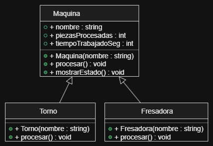
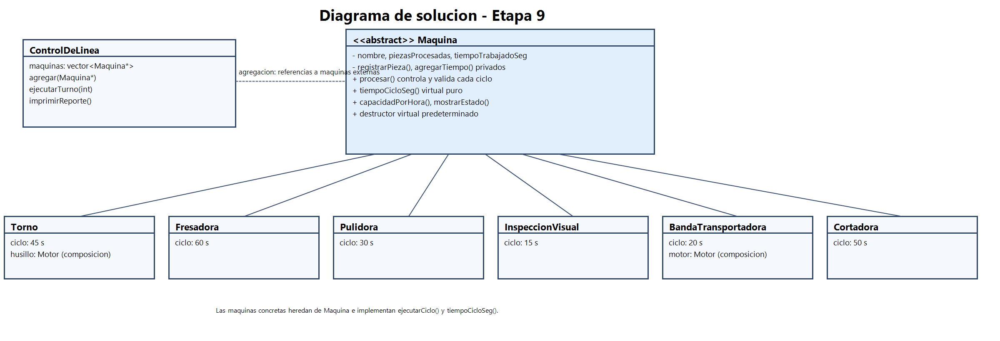

# Práctica Unidad IV: La evolución de una máquina

Programación Orientada a Objetos · Ingeniería Mecatrónica · Tercer semestre

Llena cada espacio conforme avances en las fases de [PRACTICA.md](PRACTICA.md).

## Fase 1. Entender el problema

**1.1 El problema con mis propias palabras**

Se necesita mejorar un sistema para poder controlar una linea de manufactura, en esta linea hay diferentes tipos de maquinas que son parte de un proceso. Existe la clase Maquina que funciona de forma muy superficial, el objetivo es implementar una actualizacion empleando los visto en clase.

**1.2 Reglas que siempre deben cumplirse en una máquina** (escribe al menos tres)

1. La cantidad de piezas que se procesan y el tiempo de proceso de cada maquina sera mayor o igual a cero.
2. El nombre de las maquinas debe ser una cadena de texto que no este vacia y que no contenga solo caracteres nulos.
3. El tiempo que tarda un ciclo debe ser mayor a cero para evitar divisiones entre cero.

**1.3 ¿Quién más usa la clase `Maquina`? ¿Qué podría salir mal si otro equipo crea una máquina nueva sin conocer tus reglas?**

La clase sera utlizada por otros desarroladores (mis compañeros), esta clase sera un punto de partida para heredar de esta y programar nuevas maquinas. Si un equipo nuevo de desarrolladores crearar una maquina nueva sin leer mis rerglas, podrian toparse con problemas que impidan el poder compilar, asi como cometer errores que hagan al sistema principal fallar.

## Fase 2. Diseñar la solución

**2.1 Diagrama inicial (Etapa 0)**

**2.2 Diagrama final (Etapa 9)**

**2.3 ¿Qué cambió entre los dos diagramas?**

| Elemento | Etapa 0 | Etapa 9 | Etapa que lo cambió |
| --- | --- | --- | --- |
| Visibilidad de los atributos de `Maquina` | _____ | _____ | _____ |
| `procesar()` | _____ | _____ | _____ |
| `tiempoCicloSeg()` | _____ | _____ | _____ |
| Destructor de `Maquina` | _____ | _____ | _____ |
| ¿Se pueden crear objetos `Maquina`? | _____ | _____ | _____ |
| Relación `ControlDeLinea` - `Maquina` | _____ | _____ | _____ |
| Relación `Torno` - `Motor` | _____ | _____ | _____ |
| Relación `BandaTransportadora` - `Motor` | _____ | _____ | _____ |

## Fase 3. Implementar

**3.0 Etapa 0. Una máquina sin reglas**

a) ¿Qué imprime `ejecutarTurno()` para el torno y la fresadora? ¿Por qué no imprime "torneando" ni "fresando"?

Ya que el metodo Procesar no fue declarado como virtual.

b) ¿Por qué el torno acumula 65 s y no 135 s?

Por que se ejecuto el metodo de maquina y no el de torno

**3.1 Etapa 1. Invariantes y constructores explicit**

a) ¿Qué regla de la sección 1.2 rompió `torno.piezasProcesadas = -5;`?

rompio la regla de que la cantidad de piezas procesadas no puede ser negativa.
al asignar -5 el objeto quedo en un estado invalido.

b) ¿De dónde salió la máquina "Fantasma"? ¿Qué hizo el compilador sin que se lo pidieras?

El constructor de Maquina aceptaba un string y no estaba declarado explicit, por eso, el compilador convirtio automaticamente "Fantasma" en una Maquina temporal para poder pasarla a imprimirFicha.

c) ¿Qué tuviste que cambiar en `Torno` y `Fresadora` y por qué?

Como los atributos de Maquina ahora son privados, Torno y Fresadora ya no pueden modificarlos directamente, cambie sus metodos procesar para obtener el nombre con getNombre y actualizar piezas y tiempo con registrarPieza y agregarTiempo. 
Tambien declare sus constructores explicit para evitar conversiones automaticas no intencionales.

**3.2 Etapa 2. Virtual y override**

a) La fresadora acumula 180 s, pero reporta 360 pzas/h. ¿Por qué un cálculo usó 60 s y el otro 10 s?

El metodo tiempoCicloSeg de Fresadora no tenia const, asi que no sobrescribia el metodo de Maquina.

b) ¿Tu compilador mostró alguna advertencia antes de usar `override`? ¿Qué mensaje dio después de agregar `override`?

No recuerdo.

**3.3 Etapa 3. La línea de producción**

a) ¿Por qué la línea procesó todo como "generico" si `procesar()` ya es virtual?

Porque ControlDeLinea guardaba las maquinas por valor en un vector de Maquina. Al copiarlas se perdio la parte derivada de Torno y Fresadora, asi que se produjo slicing y se ejecuto el metodo de Maquina. No entendi esto.

b) ¿Por qué el torno y la fresadora originales quedaron con 0 piezas?

Porque ControlDeLinea guardaba copias de las maquinas y el turno modifico esas copias, no los objetos originales.

c) La relación entre `ControlDeLinea` y `Maquina`, ¿es composición o agregación? ¿Por qué?

Es agregacion,la linea no las crea ni las destruye, asi que pueden seguir existiendo cuando ControlDeLinea desaparece.

**3.4 Etapa 4. Destructores**

| Momento | Mensajes de destrucción que aparecieron |
| --- | --- |
| `delete temporal;` sin destructor virtual | Destruyendo Maquina |
| `delete temporal;` con destructor virtual | Destruyendo Torno, Destruyendo Motor, Destruyendo Maquina |
| Al terminar `main` (torno y fresadora) | Destruyendo Maquina, Destruyendo Torno, Destruyendo Motor, Destruyendo Maquina |

a) ¿Qué advertencia mostró el compilador? ¿Por qué decimos que ya te estaba avisando del problema?

El compilador advirtio que borrar un objeto de tipo derivado mediante un puntero a Maquina, podia causar comportamiento indefinido. 

La advertencia anticipaba que no se destruirian correctamente las partes de Torno y su Motor.

b) ¿Por qué el torno de `main` sí se destruyó completo aunque el destructor no fuera virtual? ¿A qué máquina corresponde el primer "Destruyendo Maquina" después de "Fin de main"?

El torno de main se destruyo directamente como objeto local de tipo Torno, no a traves de un puntero a Maquina.

 El primer mensaje despues de Fin de main corresponde a la fresadora, que se creo despues del torno y se destruye primero al salir de main.

**3.5 Etapa 5. La clase abstracta**

a) Copia los mensajes de error y explica con tus palabras qué dice cada uno.

El compilador indica:

error: cannot declare variable 'pulidora' to be of abstract type 'Pulidora'
note: because the following virtual functions are pure within 'Pulidora':
note: virtual void Maquina::procesar()

error: cannot declare variable 'generica' to be of abstract type 'Maquina'
note: because the following virtual functions are pure within 'Maquina':
note: virtual void Maquina::procesar()
note: virtual int Maquina::tiempoCicloSeg() const

no se puede crear pulidora porque le falta implementar procesar. 

no se puede crear Maquina directamente porque es abstracta.

b) ¿Por qué es mejor este error de compilación que el comportamiento "generico" de antes?

Asi no se agregan maquinas que no hacen un proceso real ni se producen piezas con un comportamiento generico por accidente.

**3.6 Etapa 6. El contrato que el compilador no ve**

a) ¿Qué partes del contrato violó `InspeccionVisual`?

No registraba la pieza ni agregaba el tiempo trabajado, a parte de devolver 0 segundos, teniendo en cuenta que el tiempo de ciclo debe ser mayor que cero.

b) ¿Por qué el compilador no lo detectó?

El compilador verifica que los nombres, parametros y tipos coincidan, pero no puede saber si el comportamiento cumple las reglas del contrato.

c) ¿Qué pasaría si el próximo equipo tampoco lee el comentario del contrato?

El programa puede reportar piezas o tiempos incorrectos.

**3.7 Etapa 7. La base hace cumplir el contrato**

a) ¿Cómo puede una clase derivada sobrescribir un método que es privado en la base?

la derivada puede sobrescribir el metodo virtual privado porque private impide llamarlo directamente.

b) ¿Qué ocurre ahora con una máquina cuyo tiempo de ciclo es 0? Compáralo con la Etapa 6.

La base detecta que el tiempo no es valido y lanza una excepcion con el nombre de la maquina. 

En la etapa 6 se podia calcular una capacidad infinita y el error llegaba al reporte, ahora se detiene el procesamiento con un mensaje claro.

c) ¿Por qué la línea ignoró el "atajo" del torno, pero la llamada directa no? ¿Cómo corregiste el diseño?

La linea usa una referencia o puntero a maquina y llama al procesar no virtual de la base, por eso sigue las reglas centrales.

**3.8 Etapa 8. Herencia mal usada**

a) Da al menos dos razones por las que `BandaTransportadora : public Motor` es un error de diseño.

Una banda no es un motor. 

la herencia expone fijarVelocidad() para que cualquier parte del programa cambie directamente la velocidad de la banda.

b) La relación entre `BandaTransportadora` y `Motor`, ¿es composición o agregación? ¿Por qué?

es composicion el motor forma parte de la banda y no se comparte como un objeto externo.

**3.9 Etapa 9. La librería y la prueba final**

a) Después de agregar la `Cortadora`, ¿qué archivos mostró `git status`? ¿Cuántos archivos de la librería tuviste que modificar?

[Inserta aquí tu respuesta]

b) ¿Qué pasó al escribir `-lplanta` antes de `src/main.cpp`? ¿Por qué?

[Inserta aquí tu respuesta]

**3.10 Bitácora de dudas**

| # | Etapa | Duda | Cómo la resolví | Fuente |
| --- | --- | --- | --- | --- |
| 1 | _____ | _____ | _____ | _____ |
| 2 | _____ | _____ | _____ | _____ |
| 3 | _____ | _____ | _____ | _____ |

## Fase 4. Probar y mejorar

**4.1 Tabla de pruebas**

| # | Caso | Resultado esperado | Resultado obtenido | ¿Pasa? |
| --- | --- | --- | --- | --- |
| 1 | Máquina con nombre vacío | Excepción con mensaje claro | _____ | _____ |
| 2 | Reporte de una línea vacía | "La linea no tiene maquinas" | _____ | _____ |
| 3 | `agregar(nullptr)` | Devuelve `false` | _____ | _____ |
| 4 | Reporte antes de ejecutar el turno | 0 piezas, 0 s y capacidad calculada | _____ | _____ |
| 5 | Turno de 0 ciclos | Nada cambia | _____ | _____ |
| 6 | Torno con 3 ciclos | 3 piezas, 135 s, 80 pzas/h | _____ | _____ |
| 7 | Máquina con `tiempoCicloSeg()` igual a 0 | Excepción con mensaje claro | _____ | _____ |
| 8 | Máquina con `tiempoCicloSeg()` negativo | Excepción con mensaje claro | _____ | _____ |
| 9 | La misma máquina agregada dos veces | _____ | _____ | _____ |

**4.2 Bitácora de mejoras**

| # | Falla o mejora detectada | Qué cambié | Por qué |
| --- | --- | --- | --- |
| 1 | _____ | _____ | _____ |
| 2 | _____ | _____ | _____ |

Retos opcionales que intenté: _____

## Fase 5. Publicar en GitHub

**5.1 Enlace a mi fork**

[Inserta aquí el enlace a tu fork]

## Cierre y reflexión

**6.1 Errores que ya no pueden ocurrir**

| Error | Etapa en que apareció | Restricción que lo impide ahora | ¿Quién lo detecta: el compilador o el programa? |
| --- | --- | --- | --- |
| Contadores con valores inválidos | _____ | _____ | _____ |
| Máquina "fantasma" creada a escondidas | _____ | _____ | _____ |
| Método que no sobrescribe por un `const` | _____ | _____ | _____ |
| Máquinas copiadas y "rebanadas" | _____ | _____ | _____ |
| Destrucción incompleta | _____ | _____ | _____ |
| Máquina sin `procesar()` propio | _____ | _____ | _____ |
| Tiempo de ciclo inválido | _____ | _____ | _____ |
| Derivada que no registra sus piezas | _____ | _____ | _____ |

**6.2 ¿Cuál de los errores fue el más peligroso: el de compilación, la advertencia o el que compilaba sin problemas? ¿Por qué?**

[Inserta aquí tu respuesta]

**6.3 ¿Qué aprendiste en esta práctica?**

[Inserta aquí tu respuesta]

**6.4 ¿Qué cambiarías de tu proceso la próxima vez?**

[Inserta aquí tu respuesta]
